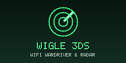
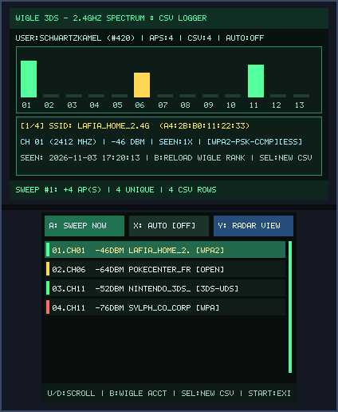
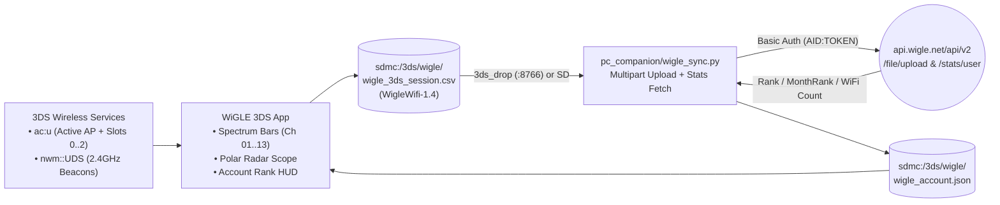

# WiGLE 3DS (`3ds_wigle`)

<p align="center">
  
  &nbsp;&nbsp;&nbsp;
  
</p>

<p align="center">
  
</p>

> **WiFi Wardriver & Radar (`CTR-P-WIGL`, UniqueId `0x0D3E4`)** — Part of the [**lafiabrew**](https://github.com/orgs/lafiabrew/repositories) Nintendo 3DS Homebrew Suite (companion hub: [`lafiabrew/3ds_hub`](https://github.com/lafiabrew/3ds_hub)).

Standards-compliant `WigleWifi-1.4` CSV wardriver, 2.4 GHz Ch 1–13 spectrum analyzer, 3DS Local Wireless (`nwm::UDS`) beacon radar, and WiGLE.net leaderboard rank viewer.

---

## Architecture & Data Flow



---

## Controls & Touch Ergonomics (Old 3DS · 2DS · New 3DS XL)

| Button / Input | Action |
|---|---|
| `A` (or Touch `A: SWEEP NOW`) | Perform an immediate 2.4 GHz AP + `ACI` slot + `nwm::UDS` beacon sweep and append to CSV |
| `X` (or Touch `X: AUTO`) | Toggle continuous **Auto-Wardrive** mode (sweeps automatically every 2 seconds) |
| `Y` / `L` / `R` (or Touch `Y: VIEW`) | Cycle Top Screen between **Ch 01–13 Spectrum Bars**, **2D Polar Radar Scope**, and **WiGLE Account Rank** |
| `B` | Reload `sdmc:/3ds/wigle/wigle_account.json` and switch to the WiGLE Leaderboard Rank view |
| `D-Pad Up / Down` (or Touch Row) | Scroll through all 64 discovered APs in the 7-row sliding table |
| `D-Pad Left / Right` | Nudge GPS longitude coordinate |
| `SELECT` | Reset in-memory AP list and start a fresh `wigle_3ds_session.csv` |
| `START` | Flush logs and exit |

---

## SD Card Paths & Telemetry Logs

- `sdmc:/3ds/wigle/wigle_3ds_session.csv` — Official 2-line header `WigleWifi-1.4` wardriving log
- `sdmc:/3ds/wigle/wigle_account.json` — Synced WiGLE username, global rank, monthly rank, and discovered Wi-Fi count
- `sdmc:/3ds/logs/wigle.log` — Structured UTC wardriving log

---

## Build, Verify & Install

```bash
# 1. Run host C11 ASan/UBSan pass-the-pass & fail-the-fail unit + UI tests
make test

# 2. Build optimized ARM11 (-Os -flto + stripped ELF) .elf, .smdh, .3dsx, and .cia
make 3ds && make verify-3ds

# 3. Serve FBI QR code or push .cia over LAN via serve_3ds.py
make qr
```
